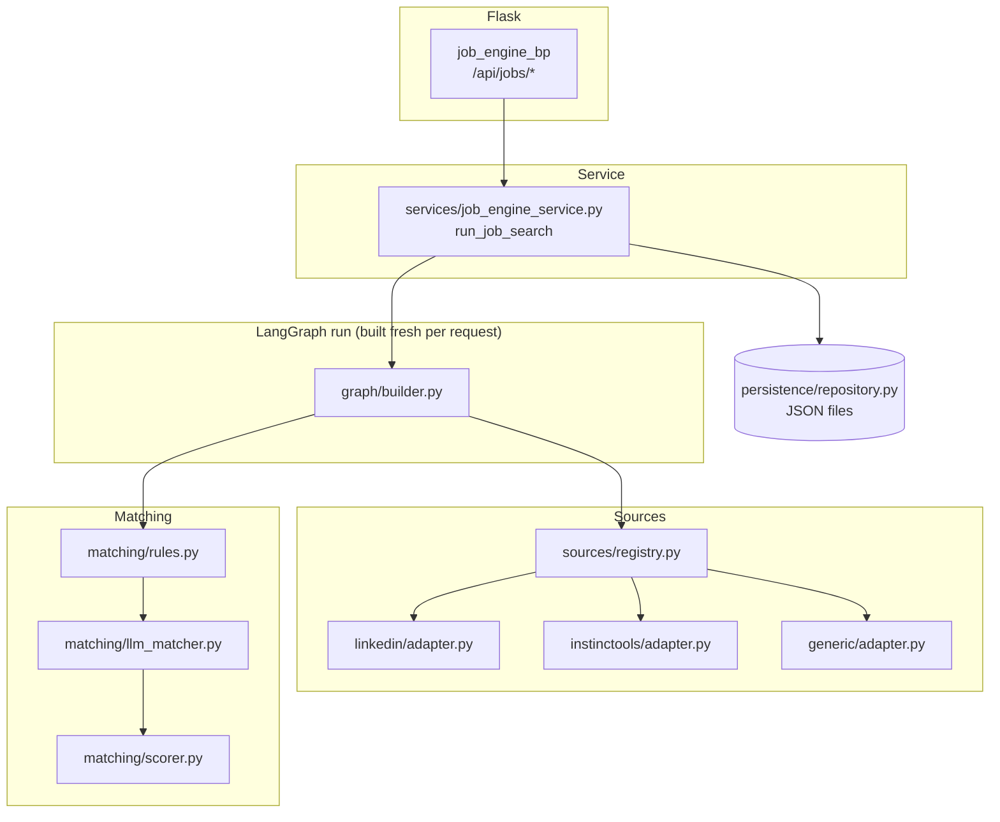
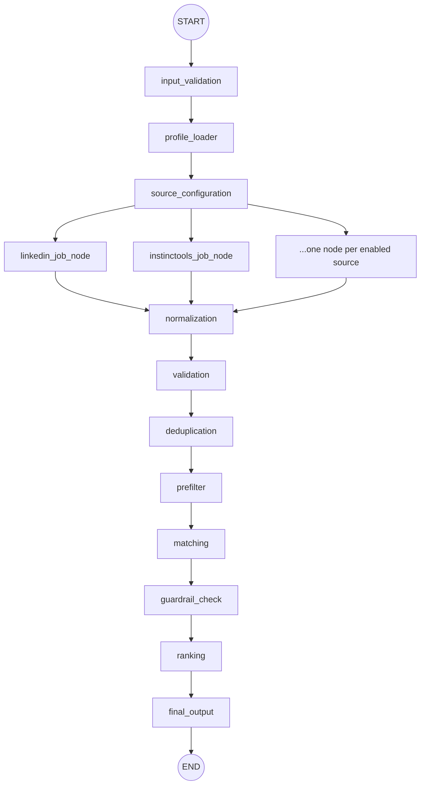
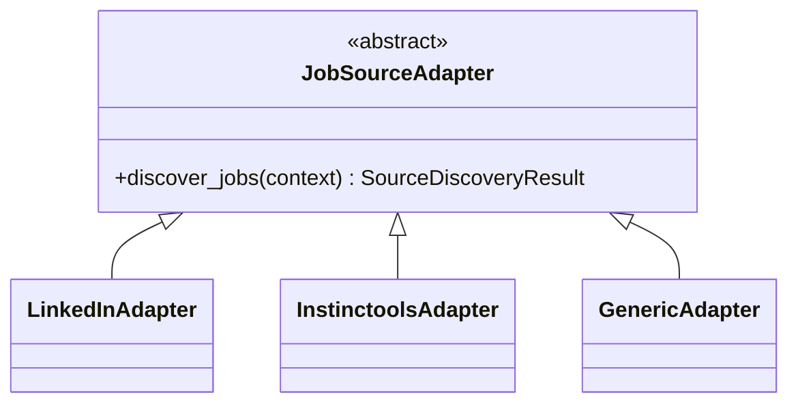
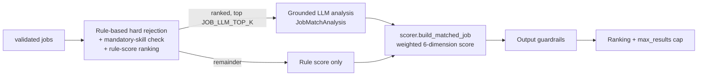

# Architecture — AI Job Discovery & Matching Engine

## Overview

## Why a graph is rebuilt per run

This repo's other two LangGraph usages (`jobSearch`, `enterpriseRAG`) compile
a module-level singleton graph with a fixed node set. This engine's node set
is *config-and-request dependent* — different runs enable different sources
— so `graph/builder.py:build_graph()` is called fresh per run from the
resolved `list[JobSourceConfig]`. This is cheap (graph wiring, not browser/
LLM work) and is what makes "add a source without touching the core graph"
possible: `graph.add_node(cfg.graph_node, create_source_node(cfg))` runs in a
loop over whatever sources are enabled.

## LangGraph flow

| Node | Responsibility |
|---|---|
| `input_validation` | Defensive second check of the request dict (API layer already validated it) |
| `profile_loader` | Parses `Profile/Summary.txt` into `CandidateProfile`, records validation warnings |
| `source_configuration` | Loads/filters `config/job_sources.yaml` against the request's `sources` filter and `JOB_MAX_SOURCES` |
| `<source>_job_node` (dynamic) | One per enabled source — see "Source-node architecture" below |
| `normalization` | `RawJob` -> `Job`: content hash, remote-type inference, per-source domain re-check |
| `validation` | Content-quality filter (request-level keyword/location/remote/employment_type filters are defined but currently disabled — see `graph/nodes/validation.py`) |
| `matching` | Every validated job gets a rule evaluation and is ranked by rule score; top `JOB_LLM_TOP_K` get a grounded LLM analysis; scorer combines everything into `MatchedJob` |
| `guardrail_check` | Output guardrails — drops jobs that fail a hard check |
| `ranking` | Deterministic sort + `max_results` cap |
| `final_output` | Assembles the `JobSearchResult` returned by the API |

## Source-node architecture (extensibility)

Every adapter implements one method and returns one typed result
(`SourceDiscoveryResult`) — `graph/nodes/source_discovery.py:create_source_node`
wraps it with circuit-breaker checks and bounded retries, so adapters never
need to worry about those concerns themselves. See
`SOURCE_ADAPTER_GUIDE.md` for how to add a new one.

## Matching pipeline (cost-optimized, multi-stage)

The six weighted dimensions (`config/settings.py:MatchingWeights`, default
30/20/15/20/10/5 for technical/role/experience/AI/architecture/domain) are
populated from the LLM's `JobMatchAnalysis` when available; `architecture_cloud`
and `domain` aren't part of that schema (they're not reliably LLM-gradeable
without more source data) so they come from keyword-overlap against the job
text, falling back to a neutral midpoint (50) when the job simply doesn't
mention architecture/cloud terms at all — a job's silence on a topic isn't
evidence against the candidate, so it shouldn't zero out a whole dimension.
The final recommendation label is always *recomputed* from the weighted
score (never taken verbatim from the LLM) — see `scorer.recommendation_for_score`.

## Error handling & isolation

- **Source isolation** (section 53): each source node catches everything
  inside its adapter and returns a `SourceError`; `graph/nodes/source_discovery.py`
  never lets an adapter's exception propagate into the graph. One source
  failing changes `source_results[id].status` to `"failed"` and appends to
  `source_errors` — it never blocks `normalization` from running once the
  other source branches complete.
- **Circuit breaker** (`sources/circuit_breaker.py`): after
  `JOB_CIRCUIT_BREAKER_THRESHOLD` consecutive failures, a source is skipped
  (not retried) for `JOB_CIRCUIT_BREAKER_COOLDOWN_SECONDS`. In-memory,
  process-local — see "Known limitations" in `SOURCE_ADAPTER_GUIDE.md`.
- **Retry** (`graph/nodes/source_discovery.py`): a source node retries its
  *entire* `discover_jobs()` call up to `JOB_BROWSER_MAX_RETRIES` times with
  linear backoff, but only when every reported error was marked `retryable`
  (network/timeout) — a `SELECTOR_MISSING` or `AUTH_REQUIRED` error is never
  blindly retried.
- **Graceful LLM degradation**: if `OPENAI_API_KEY` is unset (or
  `JOB_ENGINE_LLM_ENABLED=false`), `matching.py` sets `degraded: true` on the
  final result and every job is scored from rules only — scraped jobs are
  never discarded because the LLM is unavailable.

## Deliberate deviations from the example structure in the spec

- No `app/modules/job_engine/` wrapper — this repo has no `app/` package;
  `jobEngine/` is a new top-level package matching `jobSearch`/`jobApplyPro`/
  `enterpriseRAG`'s existing convention (see `docs/job_engine/PROJECT_ANALYSIS.md`).
  Only the `builder.py` filename and every folder from the spec's example
  (`config/`, `graph/`, `sources/`, `matching/`, `guardrails/`, `browser/`,
  `persistence/`, `observability/`, `api/`, `services/`, `prompts/`) is
  reused as-is inside it.
- Persistence is flat JSON files, not a SQL database — this project has no
  database layer anywhere else either; see `PROJECT_ANALYSIS.md`.
