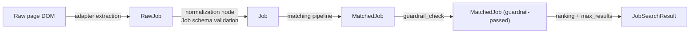
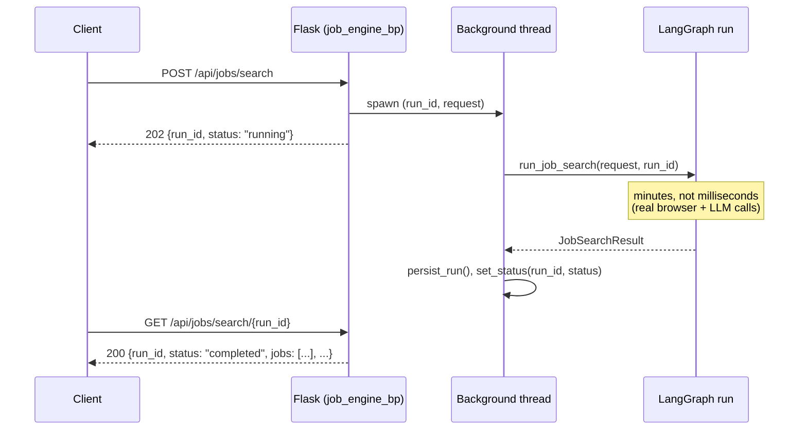

# Data Flow — AI Job Discovery & Matching Engine

## Schema transitions

Every arrow above is a Pydantic model boundary (`jobEngine/models/job.py`) —
nothing moves through the pipeline as an untyped `dict` once an adapter has
finished extracting it (adapters themselves construct `RawJob` directly, so
even the very first hop out of the DOM is typed).

## One request, start to finish

1. `POST /api/jobs/search` — `api/schemas.py:JobSearchRequest` validates the
   body (Guardrail 1). A `run_id` is minted and the run is dispatched to a
   background thread (this app has no Celery/Redis; see `ARCHITECTURE.md`).
2. `services/job_engine_service.py:run_job_search` resolves enabled sources,
   builds a fresh `BrowserManager` + `LangGraph`, and calls `graph.ainvoke`.
3. `input_validation` -> `profile_loader` -> `source_configuration` run
   sequentially (all fast, no I/O beyond parsing two small files).
4. One node per enabled source runs **concurrently** (LangGraph fans out
   real parallel branches over plain edges — see `ARCHITECTURE.md`). Each
   source node: checks its circuit breaker, opens an isolated
   `BrowserContext` (`browser/manager.py`), lets its adapter navigate
   (through `guardrails/url_guardrails.py` on every URL) and extract
   `RawJob` records, retries the whole call on retryable failures, and
   contributes to `discovered_jobs`/`source_results`/`source_errors` (all
   three use LangGraph reducers so parallel branches merge instead of
   clobbering each other — see `graph/state.py`).
5. `normalization` re-validates every job's URLs against its source's
   domain allowlist, computes a content hash, infers `remote_type`, and
   builds/validates the `Job` model — anything that fails is dropped with a
   recorded `WorkflowError`, never silently coerced.
6. `validation` drops content-free jobs (the request-level
   `keywords`/`location`/`remote`/`employment_type` filters are defined in
   the schema but currently disabled in this node — see `graph/nodes/validation.py`).
7. `matching` runs `matching/rules.py:evaluate_rules` on every validated
   job (hard-rejection + rule-score, never dropped — only marked rejected),
   ranks by rule score, sends only the top `JOB_LLM_TOP_K` to a grounded LLM
   call (cost optimization), and calls `matching/scorer.py:build_matched_job`
   for every job regardless of whether it reached the LLM stage.
8. `guardrail_check` drops any `MatchedJob` that fails a hard output
   guardrail (missing fields, PII leak, unsupported skill claim, secret
   -looking text).
9. `ranking` sorts the survivors and applies `max_results`.
10. `final_output` assembles `JobSearchResult`; the service layer times the
    whole run, persists it (`persistence/repository.py`, unless
    `JOB_ENGINE_DRY_RUN=true`), and the background thread updates the
    in-memory run-status registry so `GET /api/jobs/search/<run_id>` can
    report completion.

## What a client polls

